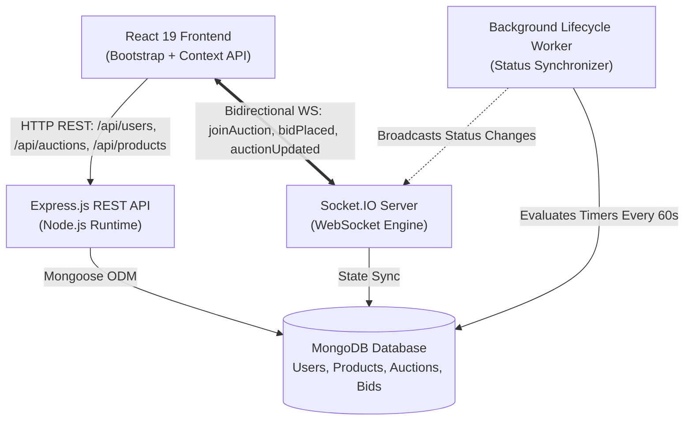

# 🏛️ AuctionHub — Real-Time Online Auction & Bidding Platform

[](https://reactjs.org/)
[](https://socket.io/)
[](https://nodejs.org/)
[](https://www.mongodb.com/)
[](LICENSE)
[](#-deployment-guide)

> An enterprise-grade, real-time online auction marketplace built with **MongoDB**, **Express**, **React 19**, **Node.js**, and **Socket.IO**. Features live room-based bidding sync, automatic auction lifecycle state machines, role-based JWT authentication, and full-stack unit testing.

---

## 🎯 Recruiter Quick Demo & Testing

For recruiters and hiring managers evaluating this project, test credentials with pre-populated listings, active auctions, and real bid histories are ready out-of-the-box:

| Role | Email | Password | Access Level |
| :--- | :--- | :--- | :--- |
| **Demo User** | `demo@auction.com` | `password123` | Active bidder & seller dashboard |
| **Platform Admin** | `admin@auction.com` | `password123` | Full administrative & moderation access |

> 💡 **Quick Tip:** The login page features a **1-Click Demo Login** button for instant evaluation without typing.

---

## 🚀 Key Features & Engineering Highlights

- **⚡ Sub-50ms Real-Time Bidding**: Socket.IO room isolation (`io.to(auctionId)`) broadcasts bids, countdown changes, and highest-bidder transitions instantaneously without page refreshes.
- **🔄 Automated Lifecycle State Machine**: Server-side periodic cron worker automatically transitions auctions from `pending` ➔ `active` ➔ `completed` and calculates winners.
- **🛡️ Secure JWT Authentication & RBAC**: Stateless JSON Web Token authentication with password hashing via `bcryptjs`, protected routes, and role-based permissions (`user`, `admin`).
- **📦 Comprehensive Product & Catalog Management**: Multi-image uploads with format validation (WEBP, PNG, JPG), categories, conditions, and starting reserve pricing.
- **📊 Real-Time Interactive Dashboard**: Track live bids placed, items listed, active auctions, and won auction receipts with status indicators.
- **🔍 Search & Multi-Criteria Filtering**: Filter live auctions and products by category, status (`active`, `pending`, `completed`), and keyword search.
- **📱 Fully Responsive UI/UX**: Designed with modern typography (Plus Jakarta Sans), responsive layouts, and accessible fallback states.
- **🧪 Unit & Integration Test Suites**: Component testing with `@testing-library/react` and server model/auth validation with Node's native test runner.

---

## 🏗️ System Architecture



---

## 🛠️ Tech Stack

### **Frontend**
- **React 19** — Modern component-driven UI with Hooks and Context API
- **React Router v7** — Declarative client-side routing with route guards (`PrivateRoute`)
- **Socket.IO Client** — WebSocket event subscriptions and real-time state sync
- **Bootstrap 5.3 & Custom CSS** — Responsive layouts, utility classes, and micro-animations
- **React DatePicker** — Intuitive scheduling for auction start and closing dates
- **Axios** — Centralized HTTP client with automatic `Authorization: Bearer` interceptors

### **Backend**
- **Node.js & Express.js** — Modular RESTful backend architecture
- **Socket.IO** — Room-based live pub/sub broadcasting
- **MongoDB & Mongoose 8** — Schema definitions, validation hooks, virtuals, and indexes
- **JWT (`jsonwebtoken`) & `bcryptjs`** — Cryptographic password hashing and stateless token auth
- **Multer** — Multi-file image upload pipeline with mime-type guards

---

## 📋 API Reference

### Authentication & Users
| Method | Endpoint | Access | Description |
| :--- | :--- | :--- | :--- |
| `POST` | `/api/users/register` | Public | Register new user account |
| `POST` | `/api/users/login` | Public | Authenticate credentials & return JWT |
| `GET` | `/api/users/profile` | Private | Retrieve authenticated user profile |
| `PUT` | `/api/users/profile` | Private | Update user details & shipping address |
| `PUT` | `/api/users/password` | Private | Change password with current password verification |

### Products
| Method | Endpoint | Access | Description |
| :--- | :--- | :--- | :--- |
| `GET` | `/api/products` | Public | List products (supports `?page=`, `?category=`, `?search=`) |
| `GET` | `/api/products/:id` | Public | Retrieve product details |
| `POST` | `/api/products` | Private | List new product for auction |
| `PUT` | `/api/products/:id` | Private | Update product listing (owner/admin) |
| `DELETE` | `/api/products/:id` | Private | Delete product listing (owner/admin) |
| `GET` | `/api/products/user/me` | Private | Retrieve all products created by logged-in user |

### Auctions
| Method | Endpoint | Access | Description |
| :--- | :--- | :--- | :--- |
| `GET` | `/api/auctions` | Public | Browse auctions (supports `?status=`, `?category=`, `?search=`) |
| `GET` | `/api/auctions/active` | Public | Retrieve currently active live auctions |
| `GET` | `/api/auctions/:id` | Public | Retrieve auction room details & increment view count |
| `POST` | `/api/auctions` | Private | Create & schedule a new auction |
| `PUT` | `/api/auctions/:id` | Private | Update pending auction parameters |
| `DELETE` | `/api/auctions/:id` | Private | Cancel pending/inactive auction |
| `GET` | `/api/auctions/user/me` | Private | Retrieve auctions created by logged-in user |

### Bids & Transactions
| Method | Endpoint | Access | Description |
| :--- | :--- | :--- | :--- |
| `POST` | `/api/bids` | Private | Place live bid (validates minimum increment & outbids previous) |
| `GET` | `/api/bids/auction/:id` | Public | Retrieve chronological bid history for an auction |
| `GET` | `/api/bids/user/me` | Private | Retrieve all bids placed by logged-in user |
| `GET` | `/api/bids/active` | Private | Retrieve currently active leading bids |
| `GET` | `/api/bids/won` | Private | Retrieve won auctions with winning hammer price |

---

## ⚡ Socket.IO Real-Time Events

| Event Name | Direction | Payload | Purpose |
| :--- | :--- | :--- | :--- |
| `joinAuction` | Client ➔ Server | `auctionId` | Join room for live auction updates |
| `leaveAuction` | Client ➔ Server | `auctionId` | Leave auction room on component unmount |
| `newBid` | Client ➔ Server | `bidData` | Transmit new bid from active user |
| `bidPlaced` | Server ➔ Room | `populatedBid` | Broadcast new highest bid to all bidders in room |
| `auctionUpdated` | Server ➔ Room | `auctionData` | Broadcast updated auction price & highest bidder |
| `auctionStatusChanged` | Server ➔ All | `auctionData` | Broadcast state transitions (`active`/`completed`) |

---

## 💻 Local Setup & Quickstart

### Prerequisites
- **Node.js** (v18.x or higher)
- **MongoDB** (Local instance or free [MongoDB Atlas](https://www.mongodb.com/atlas) cluster)

### 1. Clone the repository
```bash
git clone https://github.com/Pranavgour7/auction-platform.git
cd auction-platform
```

### 2. Install all dependencies
```bash
npm run install:all
```

### 3. Configure environment variables
Create `server/.env` (or copy from `.env.example`):
```env
MONGODB_URI=mongodb://127.0.0.1:27017/auction-platform
PORT=5000
JWT_SECRET=super_secret_jwt_key_auction_hub_2026_dev
CLIENT_URL=http://localhost:3000
NODE_ENV=development
```

### 4. Seed demo data (Recommended)
Populate the platform with realistic sample products, active auctions, and bids:
```bash
npm run seed
```

### 5. Launch development mode
```bash
npm run dev
```
- **Backend API**: `http://localhost:5000`
- **Frontend App**: `http://localhost:3000`

> Alternatively, on Windows simply double-click `start.bat`!

---

## 🌐 Cloud Deployment Guide

This project is structured for easy deployment to cloud platforms:

### Option A: Render (Unified Full-Stack Deployment)
1. Push your repository to GitHub.
2. In [Render Dashboard](https://dashboard.render.com/), click **New** ➔ **Blueprint** (uses included `render.yaml`).
3. Set your `MONGODB_URI` environment variable from your MongoDB Atlas cluster.
4. Render will automatically build the client bundle and start the unified Express server.

### Option B: Railway / Heroku
The included `Procfile` specifies:
```
web: node server/server.js
```
Set `MONGODB_URI`, `JWT_SECRET`, and `NODE_ENV=production` in your platform dashboard.

### Option C: Split Hosting (Vercel Frontend + Render Backend)
- **Frontend on Vercel**: Import `/client`, set `REACT_APP_API_URL=https://your-backend.onrender.com`.
- **Backend on Render**: Set `CLIENT_URL=https://your-frontend.vercel.app`.

---

## 🧪 Testing Suite

### Running Server Unit Tests
```bash
npm run test:server
```
Runs model validations, JWT cryptography, and authentication middleware tests using Node's test runner.

### Running Client Unit Tests
```bash
npm test
```
Executes React Testing Library test suites verifying component rendering, alert dispatching, and fallback logic.

---

## 📄 License

This project is licensed under the MIT License — see the [LICENSE](LICENSE) file for details.
